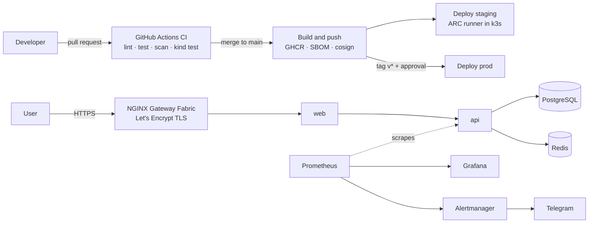

# CloudOps Platform

A multi-service application running on a k3s lab cluster. It ships only through a GitHub Actions pipeline and is watched end to end by Prometheus, Grafana and Alertmanager.

The goal of this repo is to **prove**, with repeatable tests and saved evidence, that the platform can:

- build, scan and publish container images automatically
- roll out new versions to Kubernetes **without dropping requests**
- scale under load, serve HTTPS, and keep configuration and secrets out of git
- detect failures and alert on them, then recover

> Status: 🚧 under construction. See the [roadmap](#roadmap).

## Architecture



More detail: [docs/architecture.md](docs/architecture.md)

## Stack

| Layer | Tools |
|---|---|
| Hosts | Ubuntu Server 24.04 (VMware Workstation) |
| Cluster | k3s: 1 server + 1 agent |
| App | FastAPI · static web on NGINX · PostgreSQL · Redis |
| Packaging | Docker (multi-stage, non-root) · Helm · helmfile |
| CI/CD | GitHub Actions · GHCR · Actions Runner Controller (ARC) |
| Edge | Gateway API · NGINX Gateway Fabric · cert-manager · Let's Encrypt (DNS-01) |
| Scaling | HorizontalPodAutoscaler · PodDisruptionBudget |
| Observability | kube-prometheus-stack · blackbox-exporter · Grafana · Alertmanager |
| Security | Trivy · gitleaks · Dependabot · cosign · Pod Security `restricted` · NetworkPolicies |

## Repository layout

```
app/api/            FastAPI service, migrations, tests, Dockerfile
app/web/            static frontend + NGINX config, Dockerfile
charts/taskboard/   Helm chart (staging and prod values)
platform/           gateway, cert-manager, monitoring, ARC, namespaces
scripts/            bootstrap, smoke and load tests
docs/               architecture, CI/CD, runbooks, evidence
.github/workflows/  CI, CD and rollback pipelines
```

## Roadmap

| # | Phase | Status |
|---|---|---|
| 1 | Repo, settings and tooling | 🚧 |
| 2 | Lab cluster: k3s on two Ubuntu VMs | ⬜ |
| 3 | App + hardened Dockerfiles + docker-compose | ⬜ |
| 4 | Helm chart: probes, HPA, PDB, NetworkPolicies, ConfigMap/Secret | ⬜ |
| 5 | NGINX Gateway Fabric + cert-manager + Let's Encrypt | ⬜ |
| 6 | CI: lint, tests, scans, kind integration test | ⬜ |
| 7 | CD: GHCR, ARC runners, staging → prod with approval, rollback | ⬜ |
| 8 | Monitoring: dashboards as code, alert rules, Telegram | ⬜ |
| 9 | Failure drills, evidence and final docs | ⬜ |

## Evidence

Each claim is backed by a test whose output and screenshots are saved in [`docs/evidence/`](docs/evidence/):

1. Automated release from PR to production
2. Rollout under constant load with zero failed requests
3. HPA scale-out and scale-in under a load test
4. Bad release rolled back automatically, with an alert fired
5. Node failure: alert fired, pods rescheduled, app still reachable
6. Manual rollback through a workflow
7. Full rebuild on a fresh VM from this README

## Local development

Coming in phase 3.

## License

[MIT](LICENSE)
